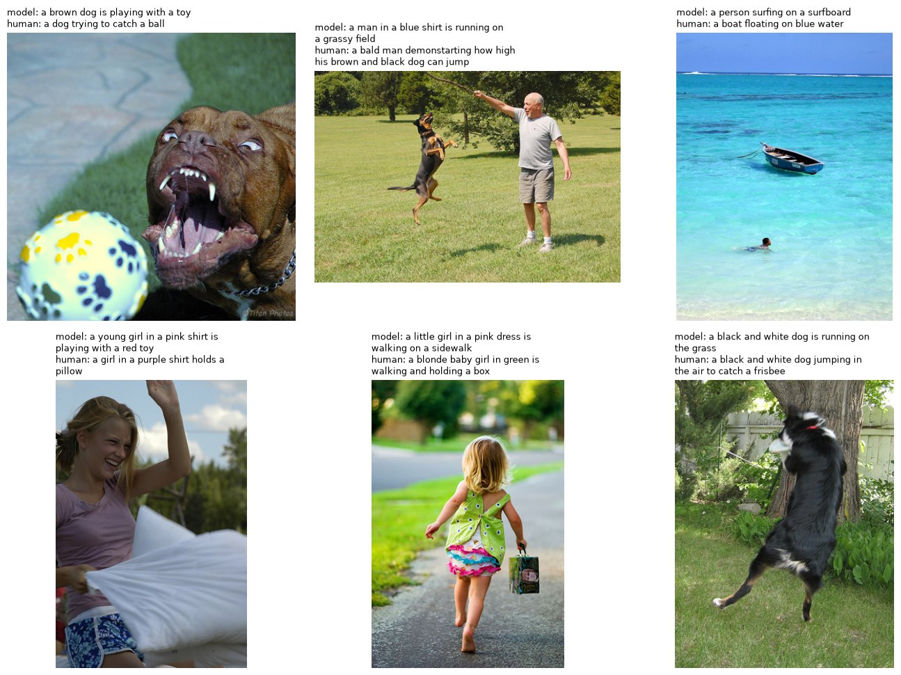
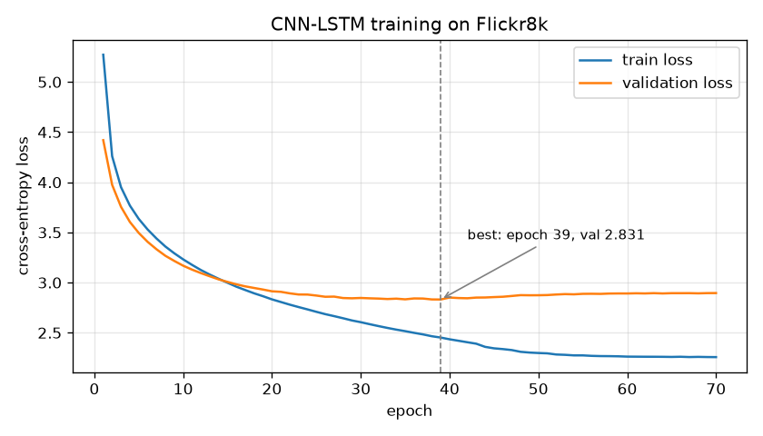
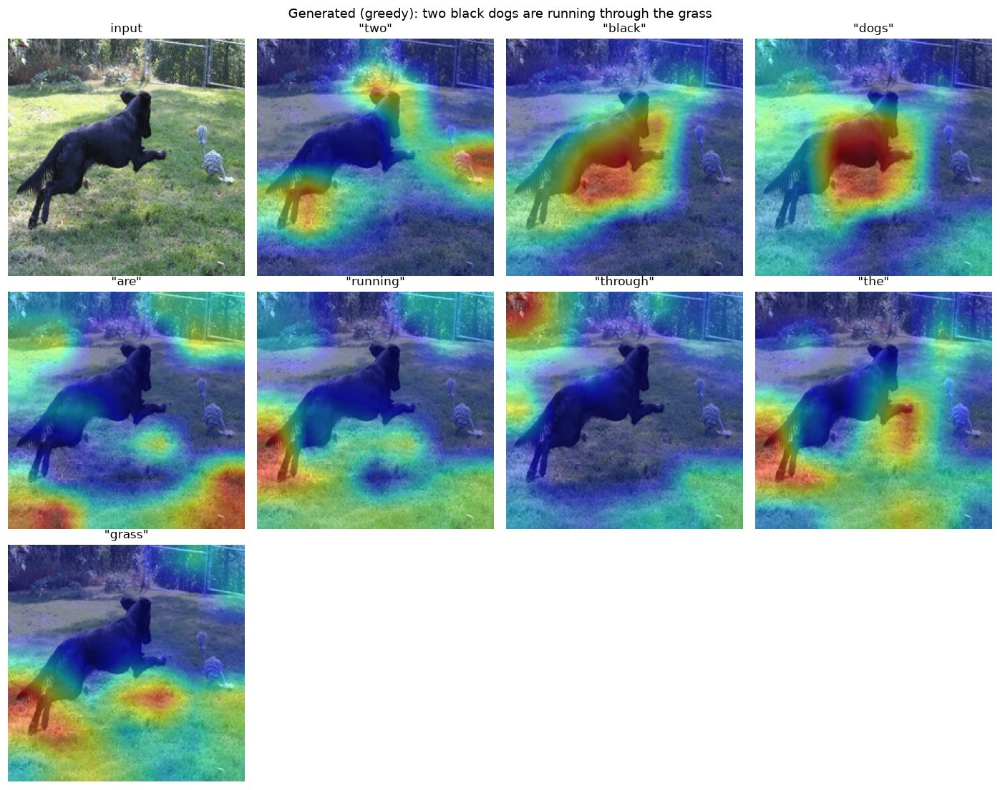

# Image Caption Generator (CNN-LSTM)

An image captioning model in PyTorch: a pre-trained **ResNet50** encodes the image and a 2-layer **LSTM** writes the description word by word. It was trained on Flickr8k, is evaluated with the standard BLEU protocol, and is inspected with **Grad-CAM** to see which image regions each word depends on.

<p align="center"></p>
<p align="center"><sub>Six <b>randomly chosen</b> test images (seed 0, not hand-picked). "model" is the generated caption; "human" is one of the five reference captions.</sub></p>

## Results

Measured on the 810 held-out test images, using the checkpoint in this repo. Each image gets one generated caption, which is scored against all 5 human references.

| Decoding | BLEU-1 | BLEU-2 | BLEU-3 | BLEU-4 | METEOR* | Distinct captions |
|---|---|---|---|---|---|---|
| Beam search (k = 3) | **0.593** | **0.408** | **0.276** | **0.187** | **0.390** | 606 / 810 |
| Greedy | 0.564 | 0.384 | 0.257 | 0.173 | 0.378 | 638 / 810 |

Reproduce with `python evaluate.py --beam_size 3`. Every generated caption is in [`results/predictions_test_beam3.csv`](results/predictions_test_beam3.csv).

For context, the attention-based *Show, Attend and Tell* (Xu et al., 2015) reported BLEU-4 0.195–0.213 on Flickr8k. Those numbers come from a different split and tokenisation, so they are only a rough reference point. \*METEOR is computed with NLTK's implementation, which gives higher values than the official METEOR used in papers, so the two can't be compared.

### Training

<p align="center"></p>

The model was trained for 70 epochs. Validation loss reached its minimum of **2.831 at epoch 39** and then rose slowly (2.895 by epoch 70) while training loss kept falling: the model began to overfit the 6,472 training images. The published checkpoint is the epoch-39 model, selected on validation loss. The raw numbers are in [`results/training_log.csv`](results/training_log.csv).

### What the model gets wrong

- **Generic captions.** Across 810 test captions the model uses only **249 distinct words**, while the human references use 2,945. It falls back on safe phrases: *"a man and a woman sit on a bench"* and *"a man and a woman pose for a picture"* each appear 11 times, *"a group of people are standing in front of a building"* 10 times. This is typical for maximum-likelihood CNN-LSTM captioners.
- **Colours and details.** In the samples above it says *pink dress* for a green dress and *blue shirt* for a grey one. It also says *a person surfing* where a person is swimming.
- **Counting.** See the Grad-CAM example below.

Beam search improves every BLEU score over greedy decoding, but it makes captions *less* varied (606 vs 638 distinct captions): it prefers the most probable, and therefore most common, phrasing.

## Explainability with Grad-CAM

<p align="center"></p>

For every generated word, the score of that word is back-propagated to ResNet50's last convolutional block (7×7 feature maps). The maps are weighted by their averaged gradients and overlaid on the image.

*black* and *dogs* focus on the dog, and *grass* on the lawn. The model also says ***two** black dogs* although there is only one. The heatmap for *two* lights up the **rope toy on the right**, so the model apparently mistook the toy for a second dog. Errors like this can't be found from BLEU scores alone.

## Model

```
image (224×224) ─► ResNet50, ImageNet weights, frozen ─► 2048-d ─► Linear + BatchNorm ─► 512-d image embedding
                                                                                        │ (first LSTM input)
<START> w1 w2 … ─► word embedding (512) ─────────────────────────────────────────────► 2-layer LSTM (512, dropout 0.5)
                                                                                        │
                                                                     Linear ─► softmax over 2,989 words ─► next word
```

| | |
|---|---|
| Parameters | 31.8 M total, **8.3 M trainable** (ResNet50 frozen) |
| Vocabulary | 2,989 tokens: words that occur ≥ 5 times, plus `<PAD>`, `<START>`, `<END>`, `<UNK>` |
| Training | Teacher forcing, cross-entropy on non-padded tokens only, Adam, gradient clipping 5.0, learning rate halved on validation plateau |
| Augmentation | Random horizontal flip, rotation ±10°, colour jitter |
| Decoding | Greedy or beam search (default beam size 3, max. 40 tokens) |

## Dataset

[Flickr8k](https://www.kaggle.com/datasets/adityajn105/flickr8k): 8,091 images, 5 human captions each. The captions are lowercased, with punctuation removed. The data is split **by image**, so no test image is ever seen in training: 6,472 / 809 / 810 images (80 / 10 / 10 %, seed 42). `preprocess.py` regenerates exactly this split.

## Usage

```bash
git clone https://github.com/Sepidehri/CaptionGenerator.git   # requires Git LFS for the checkpoint
cd CaptionGenerator
pip install -r requirements.txt
```

The trained checkpoint (`checkpoints/cnn_lstm_best.pth`, 61 MB) is stored with [Git LFS](https://git-lfs.com). If it shows up as a small text file after cloning, run `git lfs pull`.

**Caption your own images** (works on CPU, about 0.4 s per image):

```bash
python inference.py --image path/to/photo.jpg
python inference.py --image path/to/folder --max_images 20
```

**Grad-CAM for one image:**

```bash
python gradcam.py --image path/to/photo.jpg      # writes outputs/gradcam/<name>_gradcam.png
```

**Evaluate or retrain** (needs the dataset):

```bash
python download_dataset.py      # Kaggle API, or download manually into data/flickr8k/
python preprocess.py            # vocabulary + train/val/test split
python evaluate.py --beam_size 3
python train.py --epochs 40     # CUDA, Apple MPS or CPU; logs to runs/ for TensorBoard
python plot_training.py runs/cnn_lstm_exp1
```

## Project structure

```
├── models/cnn_lstm.py      encoder, decoder, greedy and beam-search decoding, checkpoint I/O
├── data/dataset.py         Flickr8k Dataset and DataLoaders (with augmentation)
├── data/vocab.py           vocabulary
├── preprocess.py           caption cleaning, vocabulary, split by image
├── train.py                training loop with validation, LR scheduling, checkpoints
├── evaluate.py             BLEU-1..4 and METEOR against all 5 references
├── inference.py            caption new images
├── gradcam.py              per-word Grad-CAM heatmaps
├── show_samples.py         random sample figure
├── plot_training.py        loss curve from TensorBoard logs
├── slim_checkpoint.py      drop optimizer state, store weights in float16 (194 MB → 61 MB)
├── checkpoints/            cnn_lstm_best.pth (Git LFS)
└── results/                metrics, all test predictions, figures
```

The published checkpoint is a slimmed copy of the training checkpoint: no optimizer state, weights stored in float16. On the test set it scores the same as the original (BLEU-4 0.1868 vs 0.1867; 2 of 810 captions differ). It contains the pickled vocabulary, so it is loaded with `weights_only=False`. Only load checkpoints from sources you trust.

## Limitations and next steps

- **No attention.** The whole image is squeezed into one 512-d vector before decoding. An attention decoder (*Show, Attend and Tell*) or a Transformer decoder can look at different regions for each word, which helps exactly with details like colour and counting.
- **Small dataset.** With 6.5k training images the model overfits after about 40 epochs. Flickr30k or MS-COCO, or fine-tuning the last ResNet block, would be the next steps.
- **Low diversity.** Beam search has no length normalisation or diversity penalty, and training uses plain cross-entropy. CIDEr-optimised training (self-critical sequence training) is the standard fix.
- **Metrics.** CIDEr, the main metric in recent captioning papers, is not implemented yet.

## Tech

Python · PyTorch · torchvision · NLTK · TensorBoard · Matplotlib
